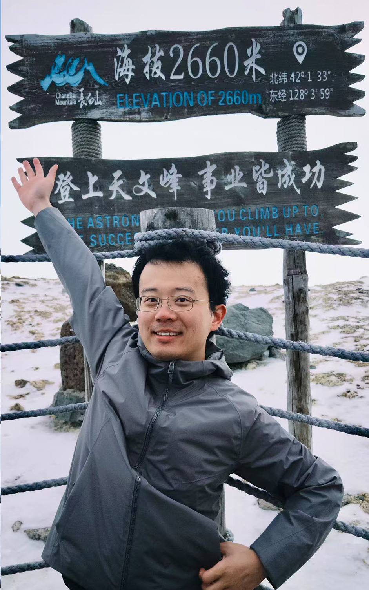

```{=html}
<div class="zk-team-page zk-wide">
<header class="zk-team-heading">
  <span class="zk-eyebrow">OUR PEOPLE / 团队成员</span>
  <h1>研究人员与知识共建者</h1>
  <p>查看藏经阁成员的个人简介、研究兴趣与公开论文。</p>
  <div class="zk-team-count"><strong>05</strong><span>FOUNDING MEMBERS / 初始成员</span></div>
</header>
<section class="zk-team-group" aria-label="课题组负责人">
<div class="zk-group-heading"><div><span class="zk-eyebrow">01 / LEADERSHIP</span><h2>课题组负责人</h2></div><span class="zk-group-en">Principal Investigator</span></div>
<a class="zk-pi-feature" href="zhao-chenguang.html">
  <div class="zk-pi-media"><div class="zk-portrait is-large has-photo"></div></div>
  <div class="zk-pi-copy"><span class="zk-pi-overline">PRINCIPAL INVESTIGATOR</span>
  <h3>赵晨光</h3>
  <p class="zk-pi-position">PI / 团队负责人</p>
  <p class="zk-pi-summary">赵晨光，北京脑科学与类脑研究所副研究员、藏经阁团队负责人。主要研究视觉注意、神经血氧耦合与经颅光生物调节，结合 EEG–fNIRS 等多模态记录方法探索非侵入性神经调控的作用机制。</p>
  <span class="zk-pi-link">查看个人主页 <span aria-hidden="true">↗</span></span></div>
</a>
</section>
<section class="zk-team-group" aria-label="博士后">
<div class="zk-group-heading"><div><span class="zk-eyebrow">02 / PEOPLE</span><h2>博士后</h2></div><span class="zk-group-en">Postdoctoral Fellows</span></div>
<div class="zk-team-portrait-grid">
<a href="li-zhilin.html" class="zk-member-card" aria-label="查看李智林的个人主页">
  <div class="zk-portrait has-photo"></div>
  <div class="zk-member-meta"><h3>李智林<span class="zk-member-arrow" aria-hidden="true">↗</span></h3><p>博士后</p></div>
</a>
</div></section>
<section class="zk-team-group" aria-label="研究生">
<div class="zk-group-heading"><div><span class="zk-eyebrow">03 / PEOPLE</span><h2>研究生</h2></div><span class="zk-group-en">Graduate Students</span></div>
<div class="zk-team-portrait-grid">
<a href="jia-hai.html" class="zk-member-card" aria-label="查看贾海的个人主页">
  <div class="zk-portrait has-photo"></div>
  <div class="zk-member-meta"><h3>贾海<span class="zk-member-arrow" aria-hidden="true">↗</span></h3><p>博士研究生</p></div>
</a>
</div></section>
<section class="zk-team-group" aria-label="团队成员">
<div class="zk-group-heading"><div><span class="zk-eyebrow">04 / PEOPLE</span><h2>团队成员</h2></div><span class="zk-group-en">Team Members</span></div>
<div class="zk-team-portrait-grid">
<a href="zhang-long.html" class="zk-member-card" aria-label="查看张龙的个人主页">
  <div class="zk-portrait is-placeholder" aria-label="张龙姓名标识"><span class="zk-portrait-monogram" aria-hidden="true">张</span></div>
  <div class="zk-member-meta"><h3>张龙<span class="zk-member-arrow" aria-hidden="true">↗</span></h3><p>团队成员</p></div>
</a>
<a href="li-minghao.html" class="zk-member-card" aria-label="查看李铭浩的个人主页">
  <div class="zk-portrait is-placeholder" aria-label="李铭浩姓名标识"><span class="zk-portrait-monogram" aria-hidden="true">李</span></div>
  <div class="zk-member-meta"><h3>李铭浩<span class="zk-member-arrow" aria-hidden="true">↗</span></h3><p>团队成员</p></div>
</a>
</div></section>
<div class="zk-team-bottom">
  <div><span class="zk-eyebrow">CONTRIBUTE TO THE ARCHIVE</span><h2>收录文献、研读证据、共建专题</h2><p>通过 GitHub 提交文献、札记和专题，参与内容维护与修订。</p></div>
  <a class="zk-outline-link" href="../join/">共建指南 <span aria-hidden="true">↗</span></a>
</div>
</div>
```
