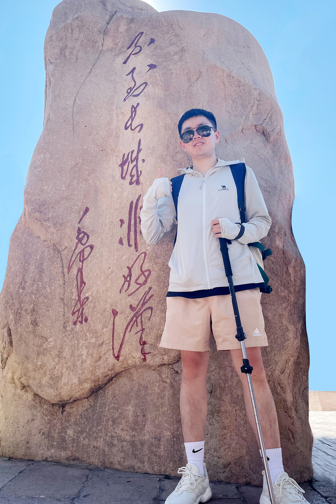

```{=html}
<div class="zk-profile-page zk-wide">
<nav class="zk-crumb" aria-label="面包屑"><a href="index.html">团队成员</a><span>/</span><span>贾海</span></nav>
<header class="zk-profile-hero">
  <div class="zk-portrait is-large has-photo"></div>
  <div class="zk-profile-intro">
    <span class="zk-eyebrow">KNOWLEDGE CONTRIBUTORS / Graduate Students</span>
    <h1>贾海</h1>
    <p class="zk-profile-name-en">Hai Jia</p>
    <p class="zk-profile-position">博士研究生</p>
    <div class="zk-profile-divider"></div>
    <p class="zk-profile-summary">贾海，北京脑科学与类脑研究中心（CIBR）与北京师范大学联合培养博士研究生，具有数学与计算数学背景。硕士阶段从事基于深度学习的生物信号解码，并参与在线脑机接口系统设计。</p>
    <a class="zk-text-link" href="index.html">← 返回团队成员</a>
  </div>
</header>
<div class="zk-profile-sections"><section class="zk-profile-section"><span class="zk-eyebrow">RESEARCH INTERESTS</span><h2>研究兴趣</h2><ul class="zk-profile-list"><li>个体脑网络引导的经颅电刺激调控与参数优化。</li><li>执行功能相关脑结构与功能网络。</li><li>深度学习、生物信号解码与脑机接口。</li></ul></section>
<section class="zk-profile-section"><span class="zk-eyebrow">BACKGROUND</span><h2>教育与科研经历</h2><ul class="zk-profile-list"><li>2024 年起：CIBR 与北京师范大学博士研究生。</li><li>2023—2024：CIBR 科研助理。</li><li>2020—2023：西华大学理学院计算数学硕士。</li><li>2016—2020：成都信息工程大学应用数学学院数学与应用数学学士。</li></ul></section>
<section class="zk-profile-section"><span class="zk-eyebrow">PUBLICATIONS</span><h2>公开成果</h2><ul class="zk-profile-list"><li>Jia, H., et al. (2023). A Model Combining Multi Branch Spectral-Temporal CNN, Efficient Channel Attention, and LightGBM for MI-BCI Classification. IEEE Transactions on Neural Systems and Rehabilitation Engineering, 31, 1311–1320。</li></ul></section></div>
<details class="zk-profile-sources"><summary>资料与图片来源</summary><ul class="zk-profile-list"><li><a href="https://cuilab.cibr.ac.cn/Team/GraduateStudents/f22ecff986ab44879be91ef9c2bbf0c0.htm" rel="noopener noreferrer">崔再续实验室个人页（2024-09-05） ↗</a></li><li><a href="https://doi.org/10.1109/TNSRE.2023.3243992" rel="noopener noreferrer">代表论文 · DOI ↗</a></li></ul><p>照片：<a href="https://cuilab.cibr.ac.cn/Team/index.htm" rel="noopener noreferrer">崔再续实验室成员页</a></p></details>
</div>
```
