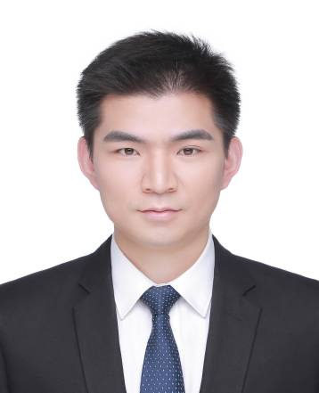

```{=html}
<div class="zk-profile-page zk-wide">
<nav class="zk-crumb" aria-label="面包屑"><a href="index.html">团队成员</a><span>/</span><span>赵晨光</span></nav>
<header class="zk-profile-hero">
  <div class="zk-portrait is-large has-photo"></div>
  <div class="zk-profile-intro">
    <span class="zk-eyebrow">KNOWLEDGE CONTRIBUTORS / Principal Investigator</span>
    <h1>赵晨光</h1>
    <p class="zk-profile-name-en">Chenguang Zhao</p>
    <p class="zk-profile-position">PI / 团队负责人</p>
    <div class="zk-profile-divider"></div>
    <p class="zk-profile-summary">赵晨光，北京脑科学与类脑研究所副研究员、藏经阁团队负责人。主要研究视觉注意、神经血氧耦合与经颅光生物调节，结合 EEG–fNIRS 等多模态记录方法探索非侵入性神经调控的作用机制。</p>
    <a class="zk-text-link" href="index.html">← 返回团队成员</a>
  </div>
</header>
<div class="zk-profile-sections"><section class="zk-profile-section"><span class="zk-eyebrow">RESEARCH INTERESTS</span><h2>研究兴趣</h2><ul class="zk-profile-list"><li>视觉注意及其电生理与血氧响应机制。</li><li>经颅光生物调节（tPBM）与认知功能调控。</li><li>EEG–fNIRS 多模态记录，以及光刺激与磁刺激的联合干预。</li></ul></section>
<section class="zk-profile-section"><span class="zk-eyebrow">BACKGROUND</span><h2>教育与科研经历</h2><ul class="zk-profile-list"><li>2015—2021：北京师范大学基础心理学硕博连续培养。</li><li>2011—2015：郑州大学通信工程学士。</li><li>2021年9月：北京师范大学认知神经工效研究中心博士后。</li></ul></section>
<section class="zk-profile-section"><span class="zk-eyebrow">PUBLICATIONS</span><h2>公开成果</h2><ul class="zk-profile-list"><li>Zhao, C., et al. (2019). Anticipatory alpha oscillation predicts attentional selection and hemodynamic response. Human Brain Mapping.</li><li>Zhao, C., Kong, Y., et al. (2023). Suppression of distracting inputs by visual-spatial cues is driven by anticipatory alpha activity. PLOS Biology.</li></ul></section></div>
<details class="zk-profile-sources"><summary>资料与图片来源</summary><ul class="zk-profile-list"><li><a href="https://muhn.edu.cn/lxy/info/1050/19762.htm" rel="noopener noreferrer">海南医科大学学术交流报道（2026-06-05） ↗</a></li><li><a href="https://zkgyy.bnu.edu.cn/yjjg/rzsjgxyjzx/rzrcdw/rzrcbshxl/121983.htm" rel="noopener noreferrer">北京师范大学个人介绍 ↗</a></li><li><a href="https://brain.bnu.edu.cn/kyjz/ab1e27fe84a74ae98c602d3fdccbe6ac.htm" rel="noopener noreferrer">北京师范大学研究报道（2023） ↗</a></li><li><a href="https://doi.org/10.1002/hbm.24619" rel="noopener noreferrer">代表论文 · DOI ↗</a></li><li><a href="https://journals.plos.org/plosbiology/article?id=10.1371/journal.pbio.3002014" rel="noopener noreferrer">代表论文 · 原文 ↗</a></li></ul><p>照片：<a href="https://sss.bnu.edu.cn/sszdw/sbsh/0b80af9d0aed4264b76d735b74a737d4.htm" rel="noopener noreferrer">北京师范大学系统科学学院</a></p></details>
</div>
```
